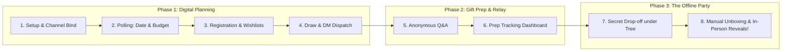

# 🥂 Offline Party Playbook (Host & Group Guide)

This playbook explains how to run the event from planning through the final **in-person party**, where the digital bot hands over to real-world fun.

---

## 📅 The 3 Phases



---

## 1. Digital Phase: Leading Up to the Party

### T-4 to T-3 Weeks: Polling & Dates
1. **Bind the Bot:** Initialize in `#secret-santa`:
   ```
   /secretsanta setup
   ```
2. **Poll the Group:**
   - Run `/secretsanta poll` for party date, time, and venue.
   - Run `/secretsanta poll` for budget limit (e.g. $25–$35).
3. **Register Participants:**
   - Post the registration embed.
   - Participants click **[Join 🎁]** and fill in their wishlist, dislikes, and party notes (e.g., favorite beverage, dietary needs).
4. **Set Exclusions:**
   - Prevent partners/roommates from drawing each other:
     ```
     /secretsanta exclude user_a:@Alice user_b:@Bob
     ```

### T-2 Weeks: The Draw
1. Host triggers:
   ```
   /secretsanta draw
   ```
2. Santas receive their secret assignment in DM:
   - Target's name, wishlist, and drink/party notes.
   - **Secret Gift Tag Code** (e.g. `🎁 CODE: POLAR-4`).

### T-2 to T-1 Weeks: Anonymous Q&A, Reminders & Progress
- If a Santa needs clarification (e.g., shoe size, book edition), they click **[Ask Baby Anonymously ✉️]** in DM.
- As Santas shop and wrap gifts, they click **[Mark as Wrapped 🎁]**.
- **Routine Updates & Reminders:**
  - The bot automatically posts daily/periodic countdown updates in `#secret-santa`.
  - The bot sends gentle private DM check-ins to Santas who have not yet wrapped their gifts.
  - The host can also manually broadcast reminders anytime using `/remind channel` or `/remind dms`.
- The main channel displays the spoiler-free progress bar:
  > **🎁 Preparation Progress:** `[████████░░]` **7 / 9 Santas are ready for the party!**


---

## 2. The Physical Party: In-Person Guidelines

When party day arrives, the bot's job is essentially done! The group can put phones away and celebrate in person.

### Step 1: The Secret Gift Drop
- Set up a designated table or space under the Christmas tree near the entrance.
- **Physical Tagging Rule:**
  - On the wrapping paper, participants write:
    - `To: [Recipient Name]`
    - `Code: [POLAR-4]` *(optional secret code from bot)*
  - **No one signs their own name!**
- Guests drop their wrapped gifts on the table as they arrive.

### Step 2: In-Person Unboxing & Guessing Ideas

Here are popular, fun ways groups conduct the unboxing manually:

#### Option A: The Chain Reaction (Recommended)
1. Pick one random person to start (e.g., draw straws or youngest person).
2. That person finds their wrapped gift under the tree and unwraps it in front of everyone.
3. They get **3 guesses** to deduce who their Secret Santa was:
   - If they guess correctly: Santa stands up, takes a bow, and receives applause.
   - If they guess wrong 3 times: Santa reveals themselves!
4. **The Chain Continues:** The person who was just revealed as the Santa is the NEXT person to unwrap their gift!
5. This creates a natural, suspenseful chain until the final gift.

#### Option B: White Elephant Steal Variant (Hybrid)
- Gifts are opened one by one, with an optional 1-steal limit before the Santa is revealed.

#### Option C: Host's Master Cheat Sheet (Backup)
- If anyone forgets who they were assigned, or if a gift code needs clarification, the host can privately run:
  ```
  /secretsanta admin export
  ```
  This displays the private cheat sheet strictly to the host, ensuring the party goes off without a hitch.
