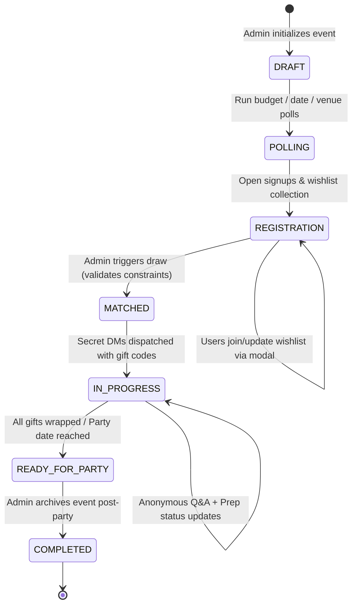

# System Specification & Architecture

## 1. System Scope & Philosophy

**Buda Secret Santa** is focused strictly on the **pre-party preparation lifecycle**:
1. Polling the group on party date, venue, and budget ceiling.
2. Registering participants and collecting wishlists via Discord Modals.
3. Managing pairing exclusions (e.g., partners/roommates).
4. Running the secret draw and dispatching private assignments with physical gift labeling codes.
5. Providing an Anonymous Q&A Relay so Santas can clarify sizes/preferences.
6. Tracking gift preparation progress with a spoiler-free countdown.

**Out of Scope for the Bot:**
- In-person party unboxing, real-time guessing games, or live party timers. All party activities are carried out manually by the group in real life.
- The bot simply provides an **Admin Backup Export** command so the organizer can privately view or print a master list if someone forgets their target or needs verification during the party.

---

## 2. Event Lifecycle & State Machine



### State Definitions

| State | Scope | Description |
| :--- | :--- | :--- |
| `DRAFT` | Channel (Admin) | Session initialized; bound to `#secret-santa`. |
| `POLLING` | Public Channel | Bot runs interactive polls for budget limit and party date/venue. |
| `REGISTRATION` | Public & DM | Users join via button; bot verifies DM capability; users submit wishlist via modal. |
| `MATCHED` | Automated Engine | Validates constraints ($N \ge 3$, exclusions); computes derangement cycle. |
| `IN_PROGRESS` | Private DMs | Santas receive target profile, physical gift tag code, and Anonymous Q&A. |
| `READY_FOR_PARTY` | Public Channel | All gifts reported ready (or party date arrived); countdown reaches zero. |
| `COMPLETED` | Database | Session archived; pairings recorded to avoid repeat matches in future years. |

---

## 3. Database Schema (SQLite / `aiosqlite`)

```sql
-- Active and historical game sessions
CREATE TABLE IF NOT EXISTS game_sessions (
    id INTEGER PRIMARY KEY AUTOINCREMENT,
    guild_id INTEGER NOT NULL,
    channel_id INTEGER NOT NULL,
    status TEXT NOT NULL DEFAULT 'DRAFT', -- 'DRAFT', 'POLLING', 'REGISTRATION', 'IN_PROGRESS', 'READY_FOR_PARTY', 'COMPLETED'
    budget TEXT,                          -- e.g. "$25 - $35"
    party_date TEXT,                      -- e.g. "2026-12-24 19:00"
    party_venue TEXT,                     -- e.g. "Alice's Place / Bistro 42"
    signup_deadline TEXT,
    created_at TIMESTAMP DEFAULT CURRENT_TIMESTAMP
);

-- Registered participants and their preferences
CREATE TABLE IF NOT EXISTS participants (
    id INTEGER PRIMARY KEY AUTOINCREMENT,
    session_id INTEGER NOT NULL,
    user_id INTEGER NOT NULL,
    username TEXT NOT NULL,
    display_name TEXT NOT NULL,
    wishlist TEXT DEFAULT '',
    dislikes TEXT DEFAULT '',
    offline_notes TEXT DEFAULT '',        -- Dietary restrictions, drink preference, arrival notes
    gift_status TEXT DEFAULT 'NOT_STARTED', -- 'NOT_STARTED', 'BOUGHT', 'WRAPPED'
    dm_verified BOOLEAN DEFAULT 0,
    FOREIGN KEY (session_id) REFERENCES game_sessions(id) ON DELETE CASCADE,
    UNIQUE (session_id, user_id)
);

-- Secret pairings
CREATE TABLE IF NOT EXISTS pairings (
    id INTEGER PRIMARY KEY AUTOINCREMENT,
    session_id INTEGER NOT NULL,
    santa_id INTEGER NOT NULL,
    baby_id INTEGER NOT NULL,
    gift_tag_code TEXT NOT NULL,          -- Code (e.g. "POLAR-4") written on physical wrapping
    assigned_at TIMESTAMP DEFAULT CURRENT_TIMESTAMP,
    gift_status TEXT DEFAULT 'NOT_STARTED', -- 'NOT_STARTED', 'BOUGHT', 'WRAPPED'
    FOREIGN KEY (session_id) REFERENCES game_sessions(id) ON DELETE CASCADE,
    UNIQUE (session_id, santa_id),
    UNIQUE (session_id, baby_id)
);

-- Exclusion constraints (e.g. couples, roommates, siblings)
CREATE TABLE IF NOT EXISTS exclusions (
    id INTEGER PRIMARY KEY AUTOINCREMENT,
    session_id INTEGER NOT NULL,
    user_a_id INTEGER NOT NULL,
    user_b_id INTEGER NOT NULL,
    FOREIGN KEY (session_id) REFERENCES game_sessions(id) ON DELETE CASCADE,
    UNIQUE (session_id, user_a_id, user_b_id)
);

-- Anonymous Relay Messages
CREATE TABLE IF NOT EXISTS relay_messages (
    id INTEGER PRIMARY KEY AUTOINCREMENT,
    session_id INTEGER NOT NULL,
    santa_id INTEGER NOT NULL,
    baby_id INTEGER NOT NULL,
    direction TEXT NOT NULL,              -- 'SANTA_TO_BABY' or 'BABY_TO_SANTA'
    content TEXT NOT NULL,
    sent_at TIMESTAMP DEFAULT CURRENT_TIMESTAMP
);
```

---

## 4. Feature Specifications

### 4.1 Channel Hub & Polling
- All public interactions are locked to the configured `SANTA_CHANNEL_ID`.
- Polling commands allow the host to post interactive vote embeds:
  - `/secretsanta poll question:"Gift Budget?" options:"$20, $30, $40"`
  - `/secretsanta poll question:"Party Date?" options:"Dec 20, Dec 21, Dec 22"`
- Host can finalize and lock the chosen budget and date into the session.

### 4.2 Registration & Modals
- Main Channel Embed features:
  - **[Join 🎁] Button**: Verifies DMs with an ephemeral check, then opens a modal dialog.
    - Fields:
      1. *Wishlist / Interests* (links, ideas, genres).
      2. *Dislikes / Allergies* (items to avoid).
      3. *Party / Drink Notes* (e.g., wine vs beer, arrival notes).
  - **[Update Wishlist 📝] Button**: Re-opens the modal with previously entered answers.
  - **[Leave ❌] Button**: Allows withdrawing before the draw.

### 4.3 Exclusion Management
- `/secretsanta exclude user_a:@Alice user_b:@Bob`
- Ensures neither person can draw the other.

### 4.4 Matching & Secret DM Dispatch
- **Manual Draw:** The host can manually execute the draw anytime using `/secretsanta draw`.
- **Automatic Draw on Deadline:**
  - When configuring `/secretsanta setup` or `/secretsanta set_deadline deadline:"3d" auto_draw:True`, the bot monitors the deadline epoch timestamp in a background loop.
  - As soon as the deadline arrives:
    1. Verifies $\ge 3$ participants have joined.
    2. Runs algorithmic derangement with backtracking to satisfy all exclusions.
    3. Saves pairings to SQLite and advances session state to `IN_PROGRESS`.
    4. Automatically dispatches private DMs to each Santa with their target's wishlist and secret gift tag code.
    5. Posts celebratory announcement to `#secret-santa`.
  - If fewer than 3 participants joined by deadline, the bot posts a friendly warning postponing the draw and keeping registration open.


### 4.5 Anonymous Q&A Relay
- Santa clicks **[Ask Baby Anonymously ✉️]** in their DM $\to$ opens modal $\to$ submits question.
- Bot relays the question to Baby's DM:
  > *"📩 Message from your Secret Santa: 'What is your T-shirt size?'"*
  > `[ Reply to Secret Santa ↩️ ]`
- Baby replies via modal; bot relays answer back to Santa.

### 4.6 Preparation Tracker & Countdown
- The main channel displays an auto-updating embed:
  > **🎄 Secret Santa Countdown to the Party!**
  > ⏳ **Days remaining:** 4 days (Dec 22, 19:00)
  > 📍 **Venue:** Alice's Place
  > 💰 **Budget:** ~$30
  >
  > **🎁 Preparation Progress:**
  > `[████████░░]` **7 / 9 Santas have wrapped their gifts!**
- No names are spoiled publicly.

### 4.7 Routine Updates & Reminders System
- **Background Task (`discord.ext.tasks`):** Runs every 24 hours (configurable via `ROUTINE_REMINDER_HOURS`).
- **Channel Broadcasts:**
  - *Registration Phase:* Sign-up reminder, deadline countdown, and current participant count.
  - *In-Progress Phase:* Party countdown, venue reminder, and preparation progress bar.
- **Smart DM Nudges:**
  - Automatically queries Santas whose gifts are still `NOT_STARTED` or `BOUGHT` (ignoring Santas who already wrapped).
  - Delivers a private DM embed reminding them of their target's name, physical gift tag code, and interactive buttons to mark as wrapped or ask questions.
- **On-Demand Admin Commands:**
  - `/remind channel [custom_note]`: Immediately posts a public reminder to `#secret-santa`.
  - `/remind dms [custom_note]`: Immediately sends reminder DMs to all unwrapped Santas.
  - `/remind user member:<Member> [custom_note]`: Sends a reminder DM to a specific user.

### 4.8 Host Emergency Backup

- `/secretsanta admin export`: Ephemerally sends the organizer a private master cheat sheet (or CSV/text summary) of all pairings and gift codes in case someone forgets who they have on party day.
- `/secretsanta admin resend @participant`: Privately re-sends a participant their target info DM.
